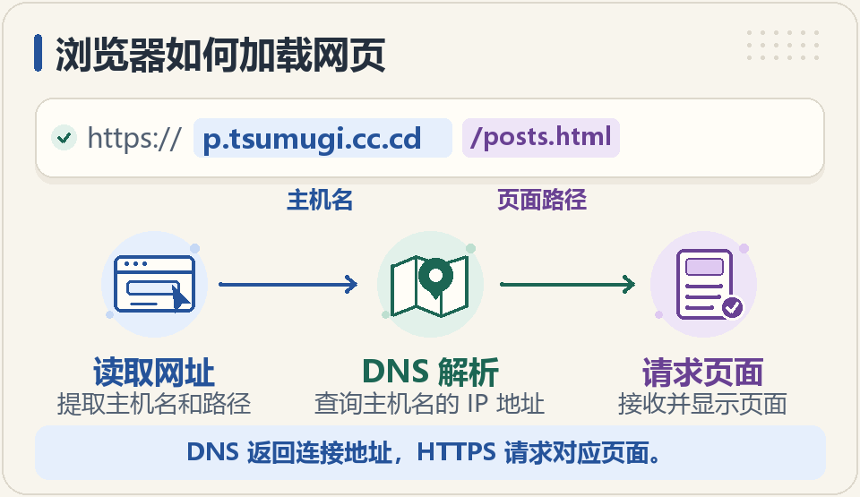
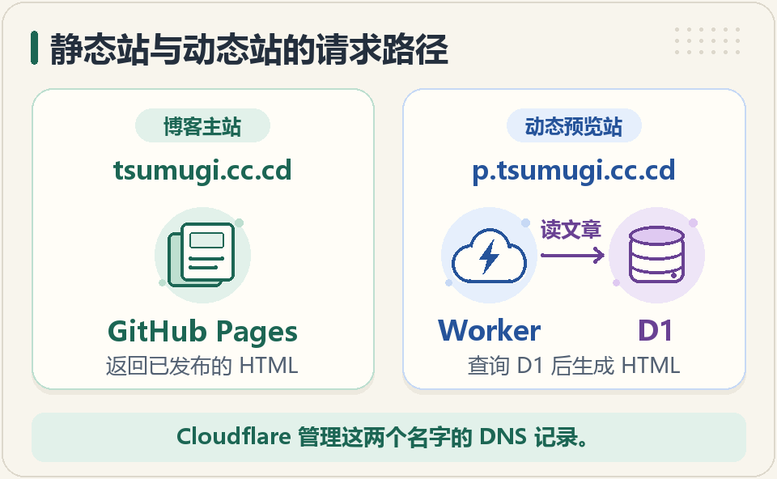
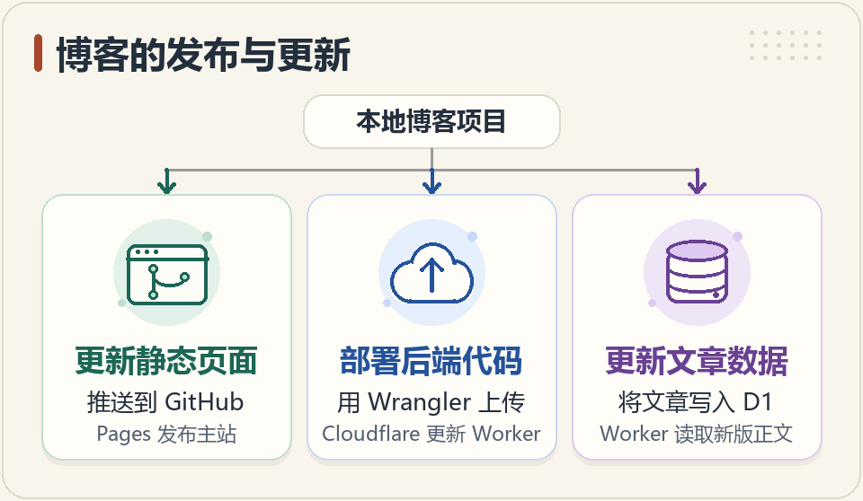

搭建个人博客可以从一个 HTML 文件开始。先用 GitHub Pages 发布静态页面，再接入自定义域名。需要按关键词搜索正文或从数据库读取文章时，可以增加由 Cloudflare Workers 和 D1 提供的动态版本。两个版本可以使用同一域名下的不同地址。

## 域名、DNS 与网页请求

以 `https://p.tsumugi.cc.cd/posts.html` 为例，`p.tsumugi.cc.cd` 是主机名，`/posts.html` 是要访问的页面路径，`https` 指定了浏览器与网站通信的协议。

**DNS（域名系统）负责把主机名解析为浏览器可连接的 IP 地址。** 浏览器取得地址后，建立 HTTPS 连接，再向网站请求 `/posts.html`。网站收到请求后，根据路径返回相应页面。DNS 查询使用主机名，页面路径随后由网站处理。 [DNS 查询图解](https://www.cloudflare.com/learning/dns/what-is-dns/)

<figure style="margin: 1.5em 0;">
  
  <figcaption>图 1　DNS 解析先确定连接地址，HTTPS 请求再指定要访问的页面。<a href="/images/cloudflare-blog/dns-lookup.png?v=tutorial" aria-label="查看 DNS 解析插画大图">查看大图</a></figcaption>
</figure>

在域名管理面板中，常用的 DNS 记录如下。

- **A / AAAA** 将主机名分别指向 IPv4 或 IPv6 地址。
- **CNAME** 将一个主机名设为另一个主机名的别名。解析时会继续查询目标主机名。
- **TXT** 保存文本。GitHub Pages 可通过指定的 TXT 记录验证域名所有权。
- **NS** 指定哪些名称服务器负责回答某个域名的 DNS 查询。这些服务器称为该域名的权威 DNS 服务器。

[Cloudflare 的 DNS 记录说明](https://developers.cloudflare.com/dns/manage-dns-records/reference/dns-record-types/)

## 使用 GitHub Pages 发布静态站

GitHub 仓库保存项目文件，GitHub Pages 负责将指定的文件发布为网站。这个阶段的页面在发布时已准备好，访问时由 Pages 直接返回，因此称为**静态网站**。

1. 在 GitHub 创建一个公开仓库，在仓库根目录新增 `index.html`。这个文件会作为首页，初次验证可以只放一个标题，例如 `<h1>个人博客首页</h1>`。
2. 在仓库的 **Settings → Pages** 中选择 **Deploy from a branch**，选中存放 `index.html` 的分支。如果文件位于仓库根目录，目录选择 **/(root)**，然后保存。
3. 发布完成后，在 Pages 设置中点击 **Visit site**。先用 GitHub 提供的地址确认首页可以打开，再配置自定义域名。

[GitHub Pages 建站步骤](https://docs.github.com/en/pages/getting-started-with-github-pages/creating-a-github-pages-site)

## 将域名接入 Cloudflare DNS

本博客使用 DNSHE 提供的免费子域名 `tsumugi.cc.cd`，并将这个域名的 DNS 查询委派给 Cloudflare。**NS 委派**决定由谁提供 DNS 记录。域名平台负责维持委派，Cloudflare 根据记录提供解析结果，网页仍可由 GitHub Pages 托管。

1. **在 Cloudflare 添加域名。** 如果已有网站或域名邮箱，先核对现用的 DNS 记录，将仍需使用的记录配置到 Cloudflare。
2. **在域名平台更新名称服务器。** 将 Cloudflare 分配的名称服务器填入注册商或上级域名提供方的管理面板。使用免费子域名时，域名提供方需支持 NS 委派，Cloudflare 也需支持添加该域名。
3. **等待区域激活。** Cloudflare 显示 **Active** 后，在 Cloudflare 管理该域名的 DNS 记录。各地解析器的缓存过期时间可能不同，因此旧记录还可能被使用一段时间。

为 GitHub Pages 绑定自定义域名时，先添加 GitHub 提供的 TXT 验证记录，再到 Pages 设置中填写自定义域名，最后按 GitHub 的说明添加用于访问的 DNS 记录。本博客将主域名配置给 GitHub Pages，并使用另一个子域名测试动态版本。 [Cloudflare 接管 DNS](https://developers.cloudflare.com/dns/zone-setups/full-setup/setup/) · [GitHub Pages 自定义域名](https://docs.github.com/en/pages/configuring-a-custom-domain-for-your-github-pages-site/managing-a-custom-domain-for-your-github-pages-site)

## 部署 Worker 并绑定 D1

**Worker** 是运行在 Cloudflare 上的后端程序，负责处理浏览器的请求。**D1** 是数据库，可以把文章数据组织成一张表，每行对应一篇文章，包含标题、日期和正文。读者访问动态站时，Worker 根据请求查询 D1，可用查到的内容生成页面或返回搜索结果。

1. **创建并部署 Worker。** 在 Cloudflare 的 **Workers & Pages** 中选择 **Create application**，从简单模板开始。点击 **Deploy** 后，用 Cloudflare 提供的 `workers.dev` 地址确认程序可以访问。
2. **创建 D1 数据库。** 在 Cloudflare 的 **D1 SQL database** 中创建数据库。验证连接时，先插入一行示例数据即可。
3. **添加 D1 绑定。** 打开 Worker 的 **Bindings → Add binding**，选择 **D1 database** 和刚建好的数据库，将变量名设为 `DB`。绑定为 Worker 提供数据库访问接口，代码可以通过 `env.DB` 发起查询。

[在控制台创建 Worker](https://developers.cloudflare.com/workers/get-started/dashboard/) · [D1 入门步骤](https://developers.cloudflare.com/d1/get-started/)

  
练习：从 D1 读取一篇文章的标题

  
打开练习数据库，在 <strong>Console</strong> 执行两条 SQL 语句。SQL 用于操作数据库。第一条创建文章表，第二条插入一行示例数据。

  <pre><code>CREATE TABLE posts (id INTEGER PRIMARY KEY, title TEXT);
INSERT INTO posts (id, title) VALUES (1, '我的第一篇博客');</code></pre>
  
在练习用 Worker 的代码编辑器中输入以下代码，点击 <strong>Deploy</strong>。<code>SELECT</code> 按文章编号查询标题，浏览器会收到纯文本「我的第一篇博客」。

  <pre><code>export default {
  async fetch(request, env) {
    const post = await env.DB
      .prepare("SELECT title FROM posts WHERE id = 1")
      .first();
    return new Response(post?.title ?? "还没有文章", {
      headers: { "Content-Type": "text/plain; charset=UTF-8" },
    });
  },
};</code></pre>

## 为动态站绑定自定义域名

确认 `workers.dev` 地址可用后，在 Worker 的 **Settings → Domains & Routes → Add → Custom Domain** 中输入要绑定的子域名。该子域名应位于已激活的 Cloudflare 区域内，并且没有冲突的 DNS 记录。绑定后，Cloudflare 会创建对应的 DNS 记录并签发 HTTPS 证书。 [给 Worker 绑定自定义域名](https://developers.cloudflare.com/workers/configuration/routing/custom-domains/)

<figure style="margin: 1.5em 0;">
  
  <figcaption>图 2　<code>tsumugi.cc.cd</code> 由 GitHub Pages 提供页面，<code>p.tsumugi.cc.cd</code> 由 Worker 处理请求。<a href="/images/cloudflare-blog/request-paths.png?v=tutorial" aria-label="查看两个网站入口的插画大图">查看大图</a></figcaption>
</figure>

在这个动态站中，Worker 收到请求后先查询正文，再将正文填入 HTML 并返回给浏览器。这一过程称为**服务端渲染**。浏览器收到的是包含正文的完整 HTML，所以「查看网页源码」仍能看到文章文字。

## 发布与更新文章

GitHub Pages 根据仓库中的 HTML 文件发布静态页面。Cloudflare **Wrangler** 命令行工具负责部署 Worker 代码和资源。动态站的文章数据通过 SQL 写入 D1。只更新动态站正文时，可以直接更新 D1 中的文章记录。

<figure style="margin: 1.5em 0;">
  
  <figcaption>图 3　静态页面、Worker 代码和文章数据各有对应的发布位置。<a href="/images/cloudflare-blog/publish-paths.png?v=tutorial" aria-label="查看博客内容发布插画大图">查看大图</a></figcaption>
</figure>

两站共用文章时，可以用 Markdown（一种纯文本写作格式）维护一份稿件。本文示例项目提供本地发文脚本，可预览文章，并将同一份稿件发布到 GitHub Pages 和 Worker，同时更新首页、文章归档和 RSS 订阅。 [项目的发文操作说明](https://github.com/MushokuK1ka/MushokuK1ka/blob/main/docs/publishing.md)
